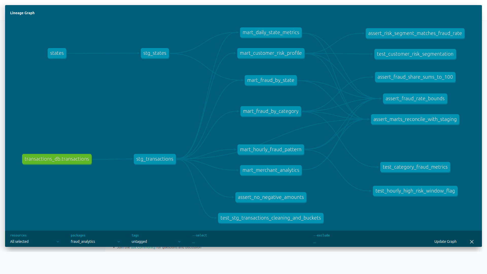
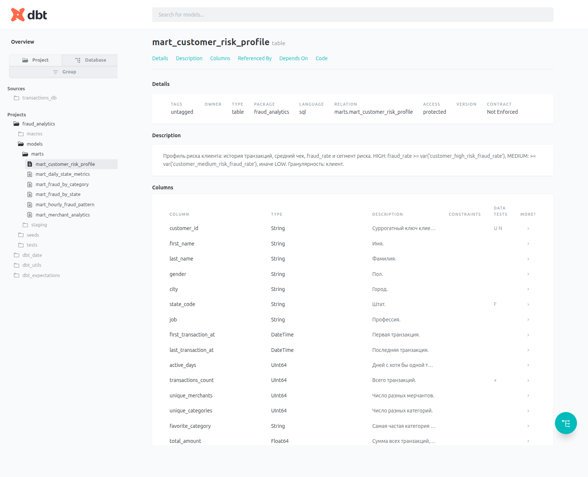

# fraudlens-dbt

dbt-проект поверх ClickHouse для аналитики карточного фрода. Сырые транзакции
(`transactions_db.transactions`, датасет из ДЗ по ClickHouse) проходят слои
**source → staging → marts**. В итоге получаются 6 витрин: по штатам, категориям, клиентам,
времени и мерчантам.



## Стек

| Компонент | Версия |
|---|---|
| ClickHouse | 24.8 (docker) |
| dbt-core | 1.10.23 |
| dbt-clickhouse | 1.10.3 |
| dbt_utils / dbt_date / dbt_expectations | 1.4.1 / 0.21.0 / 0.10.10 (см. `dbt/package-lock.yml`) |
| sqlfluff + sqlfluff-templater-dbt | 3.5.0 |
| pre-commit | 4.3.0 |

## Быстрый старт

Нужны Docker, docker-compose, Python 3.10+ и `make`.

1. Положить `train.csv` ([Kaggle](https://www.kaggle.com/t/1918f3f6435300327d38d6c596f97394)) в `data/`:

   ```bash
   mkdir -p data && unzip teta-ml-1-2025.zip train.csv -d data
   ```

2. Поставить зависимости, поднять ClickHouse и прогнать полный цикл:

   ```bash
   make install   # venv + dbt, sqlfluff, pre-commit
   make up        # ClickHouse; при первом старте грузит train.csv (786 431 строка)
   make all       # dbt deps && dbt seed && dbt run && dbt test
   make docs-serve  # dbt Docs на http://localhost:8080
   ```

Без `make`:

```bash
cd dbt
dbt deps --profiles-dir .
dbt seed --profiles-dir .
dbt run --profiles-dir .
dbt test --profiles-dir .
dbt docs generate --profiles-dir . && dbt docs serve --profiles-dir .
```

Подключение к ClickHouse задаётся через переменные окружения `CLICKHOUSE_HOST`,
`CLICKHOUSE_PORT`, `CLICKHOUSE_USER`, `CLICKHOUSE_PASSWORD`, см. `dbt/profiles.yml`.
По умолчанию используется `localhost:8123`, пользователь `default`.

Все команды: `make help`.

## Структура

```
.
├── docker-compose.yml           # ClickHouse 24.8
├── clickhouse/init/             # DDL transactions_db.transactions + загрузка data/train.csv
├── Makefile
├── .pre-commit-config.yaml
├── .sqlfluff                    # dialect=clickhouse, templater=dbt
├── requirements.txt
├── docs/                        # скриншоты dbt Docs, лог dbt test
└── dbt/
    ├── dbt_project.yml          # vars с порогами бизнес-логики, dispatch для dbt_date
    ├── packages.yml             # dbt_utils, dbt_date, dbt_expectations
    ├── profiles.yml
    ├── models/
    │   ├── sources/sources.yml
    │   ├── staging/             # stg_transactions, stg_states + схема и unit tests
    │   └── marts/               # 6 витрин + schema.yml + unit tests
    ├── macros/                  # amount_bucket, rate_pct, clickhouse-реализации dbt_date, generate_schema_name
    ├── tests/                   # singular tests
    └── seeds/states.csv         # 50 штатов + DC: название, регион и подрегион US Census
```

## Модели

Staging-модели материализуются как `view` в БД `staging`, витрины как `table`
(MergeTree) в БД `marts`.

| Модель | Гранулярность | Что внутри |
|---|---|---|
| `stg_transactions` | транзакция | Очистка строк, удаление префикса `fraud_` у мерчантов, суррогатные ключи транзакции и клиента (`dbt_utils.generate_surrogate_key`), день недели и его название (`dbt_date`), сегмент суммы (макрос `amount_bucket`), флаг крупной транзакции, расстояние клиент–мерчант |
| `stg_states` | штат | Справочник штатов из seed |
| `mart_daily_state_metrics` | дата × штат | Число транзакций, сумма, средний чек, медиана, P95, доля крупных транзакций, fraud_rate |
| `mart_fraud_by_category` | категория | Транзакции, фроды, fraud_rate, суммы, доля категории во всём фроде, ранг |
| `mart_fraud_by_state` | штат | fraud_rate, уникальные клиенты и мерчанты (всего и затронутых фродом), суммы, ранг |
| `mart_customer_risk_profile` | клиент | История (первая и последняя транзакции, активные дни), средний чек, fraud_rate, сегмент **HIGH / MEDIUM / LOW** |
| `mart_hourly_fraud_pattern` | день недели × час | fraud_rate, lift относительно среднего, флаг окна повышенного риска |
| `mart_merchant_analytics` | мерчант | Оборот, клиенты, fraud_rate, lift, флаг подозрительности, ранг по обороту |

Пороги бизнес-логики вынесены в `vars` (`dbt/dbt_project.yml`):

| var | Значение | Смысл |
|---|---|---|
| `large_amount_threshold` | 500 | крупная транзакция, USD (≈ P99 суммы) |
| `customer_high_risk_fraud_rate` | 5 | fraud_rate клиента ≥ 5% → HIGH |
| `customer_medium_risk_fraud_rate` | 1 | fraud_rate клиента ≥ 1% → MEDIUM, иначе LOW |
| `suspicious_merchant_rate_multiplier` | 2 | мерчант подозрительный, если его fraud_rate ≥ 2 × среднего |
| `high_risk_window_lift` | 2 | окно рискованное, если его fraud_rate ≥ 2 × среднего |

### Что видно в витринах

- Средний fraud_rate по датасету 0,57%. Самые рискованные категории: `shopping_net` (1,72%),
  `misc_net` (1,44%), `grocery_pos` (1,40%).
- Фрод сосредоточен ночью. Окна с 22:00 до 03:59 имеют fraud_rate 1,4–2,8%, то есть в 3–5 раз выше
  среднего. Днём он около 0,1%.
- Клиенты: 57 HIGH, 230 MEDIUM, 678 LOW. Мерчанты: 122 из 693 помечены как подозрительные.

## Макросы

- `amount_bucket(column)`: сегментация суммы `micro` (<10), `small` (<50), `medium` (<200),
  `large` (< `large_amount_threshold`), `very_large`. Используется в `stg_transactions`.
- `rate_pct(numerator, denominator, precision=4)`: доля в процентах с защитой от деления на ноль.
  Используется во всех витринах.
- `clickhouse__day_of_week`, `clickhouse__day_name`: реализации макросов `dbt_date` для ClickHouse.
  В самом пакете есть только Postgres-подобные `date_part` и `to_char`. Подключаются через `dispatch`.
- `generate_schema_name`: `+schema` используется как имя БД ClickHouse без префикса
  (`staging`, `marts`).

## Тесты

`dbt test` запускает 94 теста: 90 data tests и 4 unit tests. Лог: [`docs/dbt_test.log`](docs/dbt_test.log).

- **Generic**: `unique`, `not_null`, `accepted_values` (категории, пол, сегменты, флаги, дни недели),
  `relationships` (штаты → `stg_states`), в том числе на колонках source.
- **dbt_utils**: `unique_combination_of_columns` для ключей витрин (дата × штат, день × час),
  `expression_is_true` для инвариантов (median ≤ P95 ≤ max, fraud + legit = total и т.п.).
- **dbt_expectations**: `expect_column_values_to_be_between` (fraud_rate в [0, 100], суммы > 0,
  координаты, часы), `expect_table_row_count_to_equal` (14 категорий, 51 штат, 168 окон),
  `expect_table_row_count_to_equal_other_table` (staging = source).
- **Singular** (`dbt/tests/`):
  - `assert_no_negative_amounts`: нет неположительных сумм;
  - `assert_fraud_rate_bounds`: fraud_rate в [0, 100] во всех 6 витринах;
  - `assert_marts_reconcile_with_staging`: число транзакций и фродов в каждой витрине совпадает со staging;
  - `assert_fraud_share_sums_to_100`: доли категорий во фроде в сумме дают 100%;
  - `assert_risk_segment_matches_fraud_rate`: сегмент клиента согласован с порогами.
- **Unit tests** (dbt 1.8+, на моках входных данных):
  - `test_stg_transactions_cleaning_and_buckets`: нормализация, `fraud_` prefix, dbt_date, границы `amount_bucket`;
  - `test_customer_risk_segmentation`: HIGH/MEDIUM/LOW на границах порогов (с `overrides.vars`);
  - `test_hourly_high_risk_window_flag`: lift и флаг рискованного окна;
  - `test_category_fraud_metrics`: fraud_rate, доля во фроде и ранг.

## Линтинг и pre-commit

```bash
make lint                 # sqlfluff lint (dialect clickhouse, templater dbt)
make fix                  # sqlfluff fix
make pre-commit-install   # git-хуки
make pre-commit           # прогнать все хуки по репозиторию
```

dbt-templater компилирует модели, поэтому перед линтингом нужны `make deps` и запущенный ClickHouse.
Параметрические агрегаты ClickHouse (`quantile(0.95)(x)`, `topK(1)(x)`) sqlfluff разбирает
как два выражения в скобках и требует пробел между ними. Такие строки помечены `-- noqa: LT01`.

## dbt Docs


